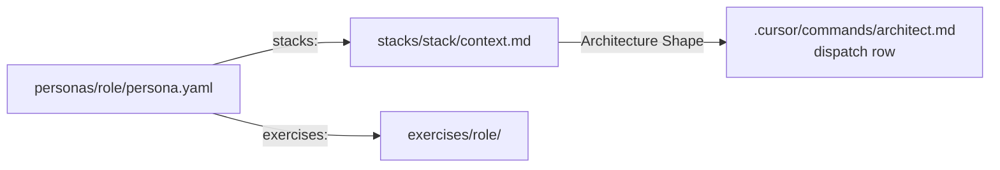

# Adaptation Guide

For instructors and teams who want to extend the course. It covers three jobs: add a persona, add a stack, add an exercise.

The commands never hardcode persona names or stack lists. They read `personas/*/persona.yaml` and `stacks/*/context.md` at runtime, so most changes are new files, not edits to commands.



## Add a persona

### 1. Create the pack

Copy an existing pack (`personas/pm/` is the smallest) to `personas/<role>/`. `/set-persona` aborts if any of these is missing:

| Path | Purpose |
|---|---|
| `persona.yaml` | The contract every command reads (schema below) |
| `persona.md` | Long-form description of the role and how it works |
| `README.md` | What the pack installs |
| `SETUP.md` | Pre-class install checklist for students |
| `hooks.json` | Hook events for this role (format below) |
| `mcp.json` | MCP servers for this role. `{"mcpServers": {}}` is valid |
| `commands/` | In-session commands, one `.md` per command. Prefix names with the role (`acct-`, `ds-`) to avoid collisions |
| `agents/` | Subagents the commands and quality gate call |
| `rules/` | `.mdc` rules. `/set-persona` rescopes them to `workspaces/<role>/**` on install |
| `scripts/` | Hook scripts (`.sh`). Installed to `.cursor/scripts/<role>/` |

### 2. Write `persona.yaml`

| Key | Type | Read by | What it means |
|---|---|---|---|
| `persona` | string | all commands | Role id. Must equal the folder name |
| `title` | string | `/set-persona`, `/start-session` | Display name in menus and summaries |
| `summary` | string | `/set-persona` | One line shown in the persona menu |
| `workspace` | path | all commands | Where the role's work lives, `workspaces/<role>`. Rules, hooks and `/architect` output are scoped here |
| `stacks` | list | `/setup-stack` | Stacks this role may install. The first entry is the default. Every entry must exist in `stacks/` |
| `exercises` | path | `/architect` | Folder of this role's exercises, `exercises/<role>` |
| `session_context` | list of paths | `/start-session`, `/read` | Files and folders loaded before the session goal is agreed. `{workspace}` is replaced. Missing paths are skipped |
| `in_session_commands` | list of `{name, use}` | `/start-session`, `/architect`, `/next-session` | Commands shown in the session summary and written into each session file. `/next-session` asks why if none ran |
| `review_focus` | list | `/code-review` | What to check on top of the stack rules. Name the agent that does each check |
| `quality_gate` | list | `/next-session` | Checks run in order before the handoff. A failure is recorded, not blocking |

### 3. Write `hooks.json`

```json
{
  "version": 1,
  "hooks": {
    "afterFileEdit": [{ "command": ".cursor/scripts/protect-raw.sh" }],
    "stop": [{ "command": ".cursor/scripts/tie-out-check.sh" }]
  }
}
```

`/set-persona` rewrites each entry to `.cursor/scripts/_scope.sh <role> .cursor/scripts/<role>/<name>.sh`. The wrapper runs `afterFileEdit` hooks only for files under `workspaces/<role>/`, and `stop` hooks only when `.cursor/.active-session` names the role. `beforeShellExecution` hooks always run.

### 4. Give it at least one stack and exercises

Every persona needs a stack (next section) and an `exercises/<role>/` folder (last section).

### 5. Verify

| Check | How |
|---|---|
| Commands branch on the persona correctly | Run the `persona-command-verifier` agent |
| Stack routing matches `persona.yaml` | Run the `setup-stack-routing-verifier` agent |
| Install and remove are clean | `/set-persona add <role>`, `/set-persona list`, `/undo persona <role>`. `.cursor/hooks.json` and `.cursor/mcp.json` must return to their previous state |
| It coexists with others | Add it next to another persona. No command or agent name clash, no rule firing outside its workspace |

## Add a stack

### 1. Create the folder

Copy `stacks/blank/` to `stacks/<stack>/`, or run `/setup-stack <role>` and type `new`. Then add the stack name to the `stacks:` list of each persona that may use it.

### 2. Meet the completeness standard

From `.cursor/agents/stack-completeness-auditor.md`. Run that agent when you are done.

| Item | Requirement |
|---|---|
| `context.md` | Sections `## Architecture Shape` (non-empty), `## Tech Stack` (with versions), `## Vibe & Style`, `## Key Rules`, `## Active Phase` |
| `rules/` | At least 4 `.mdc` files: `000-*-workflow.mdc`, `100-*-architecture.mdc`, `200-*-testing.mdc`, `300-*-style.mdc`. Each has frontmatter with `description:` and `alwaysApply: true`. `/setup-stack` rescopes them to the workspace on install |
| `templates/` | At least 2 files: a `*-starter.md` and `phase-checklist.md` |
| `vibe/` | At least 2 docs: `vibe_architecture.md` and a second one (lifecycle or similar) |
| `examples/` | At least 1 subfolder with real files, not only `.md` |

The `architect-hook-verifier` and `example-code-validator` agents check that `context.md` gives `/architect` enough to scaffold, and that examples match the stack's own rules.

### 3. Set the Architecture Shape

The first non-empty line under `## Architecture Shape` is what `/setup-stack` shows in the menu and writes to `.cursor/context.md`. Start it with the shape name, for example `REST API: ...` or `Close Workbook (...)`.

If the shape is new, add one row to the dispatch table in `.cursor/commands/architect.md`:

| Column | Fill in |
|---|---|
| Architecture Shape | The shape name from `context.md` |
| Stacks | Your stack id |
| Interface contract is... | What the plan's contract lists (routes, stages, PRD sections, tokens, tie-out points) |
| Skeleton is... | The stubs `/architect` builds after approval |
| Skeleton check | One command or check that proves the skeleton works |

Without a row, `/architect` falls back to the `{custom stack}` row and asks the student what the contract should contain.

### 4. List the prerequisites

Add the stack's runtimes to the prerequisites table in `QUICKSTART.md` and to the `SETUP.md` of each persona that uses it.

## Add an exercise

Exercises live in `exercises/<role>/<NN-name>/`. Number them in the order students do them and list them in `exercises/<role>/README.md`.

| Path | Contents |
|---|---|
| `README.md` | Scenario, inputs, task, "done when", commands to use, stretch goal. This is what students pass to `/architect` |
| `inputs/` or `data/` | Files the exercise needs. Shared Northwind data stays in `exercises/_data/northwind/` and is referenced, not copied |
| `checks/` | How the work is graded: Hurl tests for engineers, answer keys for PM, token and a11y checks for designers, expected findings for DS, tie-outs for accountants |
| `SOLUTION.md` | Instructor key. Expected results and the seeded traps |

Rules for a good exercise:

| Rule | Why |
|---|---|
| Synthetic data only, on Northwind Co. | No company systems, no real people |
| "Done when" is a command or a check | Students and the AI both know when to stop |
| Uses the role's own tools | A Java developer builds in Java, an accountant works in spreadsheets |
| Engineer checks are language-neutral | One Hurl suite over HTTP grades all six stacks |
| Seed one trap per exercise | Leakage, a duplicate, a flawed story. `SOLUTION.md` names it |
| Fits one or two sessions | `/architect` splits anything bigger than 1 to 4 hours |
