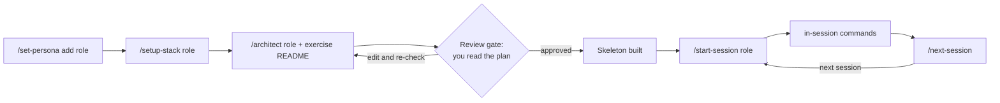

# Quickstart

Fifteen minutes from clone to your first plan. You pick one persona, run its flow on exercise 01, and stop at the review gate.

Everything runs in Cursor. All data is synthetic. Engineers build a Blog API; the other personas work on the fictional company Northwind Co. You need no company accounts or tools.

## 1. Prerequisites

Everyone needs Cursor, git and python3. The hooks use python3; macOS ships with it. Beyond that, each exercise uses your role's own tools and language. Install only what your persona and stack need.

| Persona | Stack | Install | Check |
|---|---|---|---|
| everyone | any | Cursor, git, python3 (for the hooks) | `git --version`, `python3 --version` |
| engineer | python-fastapi | Python 3.11+, Hurl | `python3 --version`, `hurl --version` |
| engineer | java-spring | JDK 21, Maven 3.9+, Hurl | `java -version`, `mvn -v` |
| engineer | go-gin | Go 1.22+, Hurl | `go version` |
| engineer | go-grpc | Go 1.22+, Hurl, grpcurl | `grpcurl --version` |
| engineer | node-express, node-nestjs | Node.js 20+, Hurl | `node --version` |
| pm | pm-prd-markdown | nothing beyond Cursor | |
| designer | designer-react-tokens | Node.js 20+ | `node --version` |
| data-scientist | python-datascience, python-mlops | Python 3.11+ | `python3 --version` |
| data-scientist | python-spark | Python 3.11+, JDK 17 or 21 | `java -version` |
| data-scientist | python-dbt-snowflake | Python 3.11+, dbt Core 1.8+ | `dbt --version` |
| data-scientist | r-tidyverse | R 4.4+ | `R --version` |
| accountant | sheets-accounting (default) | Excel or any spreadsheet app | |
| accountant | python-accounting (scripted) | Python 3.11+ | `python3 --version` |

Hurl runs the engineer acceptance tests: `brew install hurl` (other platforms: https://hurl.dev). The optional MCP servers start with `npx`, so they need Node.js 20+. Exercise 01 works without them.

The shared Northwind data is already in `exercises/_data/northwind/`. You never run a generator.

Each persona has a longer checklist in `personas/<role>/SETUP.md`. Do it before class if you can.

## 2. Clone and open

```bash
git clone https://github.com/axel-sirota/cursor-course-templates
cd cursor-course-templates
git checkout intuit-cursor
cursor .
```

Open the Cursor chat (Agent mode). Every command below is typed there.

## 3. The flow



| Step | What happens | Where it writes |
|---|---|---|
| `/set-persona add <role>` | Installs the persona's commands, agents, rules, hooks and MCP servers | `.cursor/`, `workspaces/<role>/` |
| `/setup-stack <role>` | Installs the stack rules, templates and examples | `.cursor/rules/<role>/`, `workspaces/<role>/` |
| `/architect <role> <exercise README>` | Writes the interface contract and session files, then stops for your review. Builds the skeleton only after you say "approved" | `workspaces/<role>/plans/` |
| `/start-session <role>` | Loads rules and plan, agrees the session goal | `.cursor/.active-session` |
| in-session commands | The persona's own commands (table below) | `workspaces/<role>/` |
| `/next-session` | Runs the quality gate, writes the handoff | `workspaces/<role>/plans/transitions/latest.md` |

`/read` shows every active persona and its next step at any time.

## 4. Pick a persona and run exercise 01

Each exercise lives in its own folder under `exercises/<role>/`. The list is in `exercises/<role>/README.md`. When you pass the exercise README to `/architect`, type `@` and pick the file so Cursor attaches the right path.

### Engineer

The engineer exercise is the Blog API (auth, posts, comments, tags), built in phases in your own stack. Hurl tests grade it over HTTP, so any of the six stacks works. Phases and folders are in `exercises/engineer/README.md`.

```
/set-persona add engineer
/setup-stack engineer            # python-fastapi (default), go-gin, go-grpc, java-spring, node-express, node-nestjs
/architect engineer @exercises/engineer/<01 folder>/README.md
/start-session engineer
/engineer-tasks
/engineer-implement
/code-review
/next-session
```

Start your server, then run the acceptance tests from a terminal:

```bash
exercises/engineer/run-acceptance.sh <exercise>
```

### Product manager

Exercise 01: interview notes to PRD.

```
/set-persona add pm
/setup-stack pm                  # pm-prd-markdown
/architect pm @exercises/pm/<01 folder>/README.md
/start-session pm
/pm-decompose
/pm-validate
/pm-report
/next-session
```

The check is `/pm-validate` plus the exercise answer key. The stack's `check_prd.py` is optional.

### Designer

Exercise 01: brand brief to design tokens.

```
/set-persona add designer
/setup-stack designer            # designer-react-tokens
/architect designer @exercises/designer/<01 folder>/README.md
/start-session designer
/designer-extract
/designer-compose
/designer-iterate
/next-session
```

### Data scientist

Exercise 01: exploratory analysis of Northwind expenses.

```
/set-persona add data-scientist
/setup-stack data-scientist      # python-datascience (default), python-mlops, python-spark, python-dbt-snowflake, r-tidyverse
/architect data-scientist @exercises/data-scientist/<01 folder>/README.md
/start-session data-scientist
/ds-explore
/ds-validate
/next-session
```

### Accountant

Exercise 01: October bank reconciliation.

```
/set-persona add accountant
/setup-stack accountant          # sheets-accounting (default, no code), python-accounting (scripted)
/architect accountant @exercises/accountant/<01 folder>/README.md
/start-session accountant
/acct-reconcile
/next-session
```

On sheets-accounting, Cursor writes the CSV/XLSX workbook and a markdown memo. You review them in Excel or Google Sheets.

You are done with the quickstart when `workspaces/<role>/plans/sessions/session-overview.md` exists and the skeleton check printed by `/architect` passed. The exercise README says when the exercise itself is done.

## 5. Troubleshooting

| Symptom | Cause | Fix |
|---|---|---|
| "No persona configured. Run /set-persona first." | No persona is active | `/set-persona add <role>` |
| "`<role>` is not active." | You ran a command for a role you have not added | `/set-persona add <role>`, or `/set-persona list` to see what is active |
| "Run `/setup-stack <role>` first." | Stack not set for that role | `/setup-stack <role>` |
| "Run `/architect <role>` first. A session needs a plan." | No `session-overview.md` yet | `/architect <role> @<exercise README>` |
| `/architect` stopped and built nothing | That is the review gate | Read `workspaces/<role>/plans/`, then reply "approved" |
| "`<role>` already uses `<stack>`." | You want a different stack | `/undo stack <role>`, then `/setup-stack <role>` |
| Persona commands missing from the `/` menu | Cursor has not reloaded `.cursor/commands/` | Reload the window (Cmd/Ctrl+Shift+P, "Reload Window") |
| MCP server shows an error | Node.js missing or `npx` blocked | Install Node 20+, then restart Cursor. MCP servers are optional for exercise 01 |
| A rule fires on the wrong files | Rules are scoped to `workspaces/<role>/**` | Keep your work inside your persona's workspace |
| Something is installed wrong | | `/undo persona <role>` and start again. Your workspace is kept |

Next: `student_runbook.md` for the full day, or `CHOOSE_YOUR_ADVENTURE.md` if you are not sure which persona to pick.
