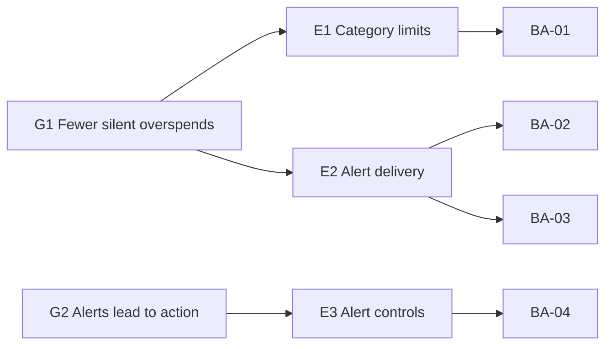

# PRD: Budget Alerts

| Field | Value |
|---|---|
| Owner | PM, Budgeting squad |
| Status | Validated |
| Last updated | 2026-10-28 |
| Product | Fictional personal budgeting app (course example) |

## Problem

Household budgeters set a monthly plan, then find out they overspent when the month closes.
In the October survey, 38% of [active budgeters](../glossary.md#active-budgeter) said they went over a [category limit](../glossary.md#category-limit) without noticing.
The app shows a red bar only when the user opens the Budget tab, and 61% of active users open it less than once a week.
Doing nothing keeps the main churn reason in exit surveys ("I forgot to check") at 22% of cancellations.
Source: [research/2026-10-14-budgeter-survey.md](../research/2026-10-14-budgeter-survey.md).

## Goals

- **G1:** Cut the share of active budgeters who overspend a category without noticing from 38% to 20% within 90 days of launch.
- **G2:** At least 30% of alerts lead to an app open within 24 hours, measured over the first 60 days.

## Non-goals

- No SMS alerts in v1: cost per message is too high for the free tier.
- No automatic changes to a limit. The app suggests, the budgeter decides.
- No shared household alerts. Shared budgets ship in a separate PRD.
- No alerts for income or savings goals. Spending categories only.

## Users

| User | Context |
|---|---|
| Household budgeter | Owns the monthly plan, checks the app on a phone, wants to hear about trouble before payday. |
| Light tracker | Links accounts but rarely opens the app. Most at risk of silent overspending. |

## Epics

| ID | Epic | Goal | Stories |
|---|---|---|---|
| E1 | Category limits | G1 | BA-01 |
| E2 | Alert delivery | G1 | BA-02, BA-03 |
| E3 | Alert controls | G2 | BA-04 |

## User Stories

| ID | Title | Epic | Size | File |
|---|---|---|---|---|
| BA-01 | Set a monthly limit per category | E1 | S | [budget-alerts-01-set-category-limit.md](../stories/budget-alerts-01-set-category-limit.md) |
| BA-02 | Warn at 80% of a limit | E2 | M | [budget-alerts-02-threshold-warning.md](../stories/budget-alerts-02-threshold-warning.md) |
| BA-03 | Alert when a limit is exceeded | E2 | S | [budget-alerts-03-overspend-alert.md](../stories/budget-alerts-03-overspend-alert.md) |
| BA-04 | Mute alerts for one category | E3 | S | [budget-alerts-04-mute-category.md](../stories/budget-alerts-04-mute-category.md) |

## Non-functional Requirements

### Performance

- **NFR-PERF-1:** p95 time from a transaction posting to the alert being sent is under 5 minutes.
- **NFR-PERF-2:** The limit editor saves in under 1 second at p95 on a 4G connection.

### Security

- **NFR-SEC-1:** Alert payloads hold category name and amounts only. Data class: Confidential (level 2 of 4).
- **NFR-SEC-2:** Push notifications never show account numbers or merchant names on a locked screen.

### Privacy

- **NFR-PRIV-1:** Alert history is kept for 90 days, then deleted.
- **NFR-PRIV-2:** Alerts are opt-in. Consent is asked once, at the first limit save, and can be withdrawn in 1 tap.

### Accessibility

- **NFR-A11Y-1:** Limit editor and alert settings meet WCAG 2.2 AA.
- **NFR-A11Y-2:** Alert text does not rely on color. Every alert states the percent spent in words.

### Internationalization

- **NFR-I18N-1:** Ships in 3 locales: en-US, es-US, fr-CA.
- **NFR-I18N-2:** Amounts use the account currency and the locale number format (1,234.50 vs 1 234,50).

### Observability

- **NFR-OBS-1:** Emit `alerts_sent_total`, `alerts_failed_total` and `alert_latency_seconds` per alert type.
- **NFR-OBS-2:** Page the on-call engineer if failed alerts exceed 1% over 15 minutes.

## Edge Cases

| ID | Scenario | Handled by |
|---|---|---|
| EC1 | A refund lowers spending back under 80% after a warning was sent | BA-02 |
| EC2 | One transaction jumps a category from 50% straight past 100% | BA-03 |
| EC3 | A limit is lowered below the amount already spent this month | BA-01 |
| EC4 | The user mutes a category, then exceeds its limit | BA-04 |
| EC5 | Push permission is off at the operating system level | BA-02 |

## Dependencies

| Dependency | Owner | Needed for |
|---|---|---|
| Transaction categorization service posts events within 2 minutes | Data platform squad | BA-02, BA-03 |
| Push notification service supports per-category templates | Mobile platform squad | BA-02, BA-03 |
| Decision on default threshold | PM | BA-02, see [decisions/2026-10-20-default-threshold.md](../decisions/2026-10-20-default-threshold.md) |

## Rollout Plan

1. Week 1: internal staff only, behind the `budget_alerts` feature flag.
2. Week 2: 10% of active budgeters in en-US. Watch NFR-OBS-2 and opt-out rate.
3. Week 4: 100% of en-US, then es-US and fr-CA one week later.
4. Rollback: turn the flag off. Limits stay saved. No alert is sent while the flag is off.

## Success Metrics

| Metric | Baseline | Target | Window | Goal |
|---|---|---|---|---|
| Budgeters who overspend without noticing (survey) | 38% | 20% | 90 days after 100% rollout | G1 |
| Alerts followed by an app open within 24 h | n/a | 30% | First 60 days | G2 |
| Alert opt-out rate | n/a | under 10% | First 60 days | G2 |

## Open Questions

| ID | Question | Owner | Due |
|---|---|---|---|
| Q1 | Do budget alerts count toward the 3-per-day notification cap? | PM | 2026-11-15 |
| Q2 | Should fr-CA copy be reviewed by the legal team for consent wording? | Privacy lead | 2026-11-20 |
