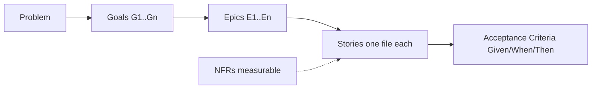

# Vibe: PRD Workspace Architecture

## The idea

A PRD is a small codebase written in markdown.
Files have a fixed layout. IDs link them. A checker fails the build when a link breaks.
Engineering reads the result and builds without guessing.

## The shape

Read it left to right. Every box on the right traces back to a box on the left.
A story with no epic, or an epic with no goal, is dead weight. Cut it or link it.

## Why one story per file

- Diffs stay small. A change to BA-03 touches one file.
- Reviews stay focused. A reviewer comments on one story, not a 900-line PRD.
- Tickets map 1 to 1 to files. `/pm-decompose` has a clean source.
- IDs live in file names, so a broken link is easy to spot.

## Why the PRD keeps only an index

The PRD answers "why" and "what". Stories answer "who does what, and how we know it works".
If story text lives in both places, the two copies drift. Keep one copy, in the story file.

## Folders and what goes in them

| Folder | Holds | Never holds |
|---|---|---|
| `prds/` | One PRD per feature | Raw notes, tickets |
| `stories/` | One story per file | Implementation tasks |
| `research/` | Interviews, surveys, data pulls | Requirements |
| `decisions/` | Settled trade-offs with an owner | Open questions |
| `docs/` | Output of `/pm-validate`, `/pm-decompose`, `/pm-report` | Hand edits |
| `glossary.md` | Domain terms | Feature descriptions |

## The checks are the tests

| Check | Catches |
|---|---|
| `markdownlint-cli2` | Broken formatting, skipped heading levels, code fences with no language |
| `check_prd.py` | Missing sections, stories without Given/When/Then, broken traceability |
| `check_prd.py --strict` | Leftover TODOs, NFRs with no number, goals with no epic |
| `/pm-validate` | Judgment: feasibility, missing edge cases, weak sections |

Machines check structure. People and the Three Amigos agents check meaning.

## What this stack is not

- Not a ticket tracker. Jira and GitHub Issues receive tickets after review.
- Not a design tool. Screens belong to the designer persona.
- Not an engineering spec. Endpoints and tables belong to the engineer persona.
