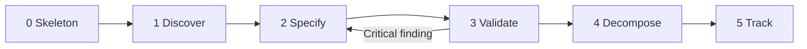

# Vibe: PRD Lifecycle

## Six phases, one file tree



The only loop is Validate back to Specify. Every other step moves forward.

## Phase by phase

| Phase | You write | Claude or Cursor helps with | Exit check |
|---|---|---|---|
| 0 Skeleton | Nothing yet | `/architect pm` lays out headings and folders | `check_prd.py .` passes |
| 1 Discover | Problem, goals, non-goals, users | Summarizing `research/` notes into facts with numbers | Every goal has a metric |
| 2 Specify | Epics, stories, AC, NFRs, rollout | Drafting Given/When/Then from a story line | `check_prd.py . --strict` passes |
| 3 Validate | Fixes to flagged gaps | `/pm-validate`: dev, QA and gap-detector agents | "Ready to decompose: Yes" |
| 4 Decompose | Review of the ticket list | `/pm-decompose`: ordered tickets | Acyclic dependency graph |
| 5 Track | Stakeholder notes | `/pm-report`: status from the tracker | Report shared |

## A session in practice

1. `/start-session pm` loads the PRD, the last transition doc and the active phase.
2. Pick one section or one story. Not the whole PRD.
3. Edit in markdown. The `invest-validator` and `ac-format-check` hooks warn when you save a file in `prds/`. Story files rely on `check_prd.py`.
4. Run the two checks before you stop:

   ```bash
   npx markdownlint-cli2@0.18.1
   python3 scripts/check_prd.py .
   ```

5. `/next-session pm` records story counts and what is left.

## How AI fits

- Good use: turn interview notes into a draft Problem paragraph with the numbers cited.
- Good use: propose edge cases for a story, then you pick the real ones.
- Good use: rewrite a vague AC into Given/When/Then with real values.
- Bad use: invent goals or metrics. Numbers come from `research/`, not from the model.
- Bad use: generate 20 stories at once. Write the epic, then add stories one at a time.

## Signs a PRD is drifting

| Sign | Fix |
|---|---|
| A story has 6 or more AC | Split it |
| A goal has no number | Go back to Discover |
| Two stories share most of their AC | Merge them or name the difference |
| Open questions have no owner | Assign or delete |
| The PRD and a ticket disagree | Update the story file first, then the ticket |

## Done means

The strict check passes, `/pm-validate` says yes, and an engineer can size every story without asking you a question.
