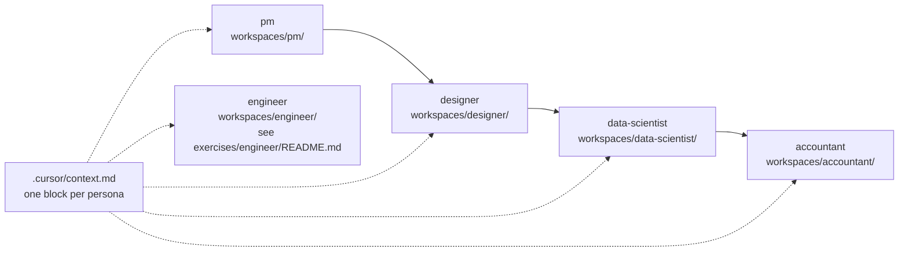

# Student Runbook

Keep this open during class. It lists the commands to type at each step, for each persona, from exercise 01 to the capstone.

Setup and prerequisites are in `QUICKSTART.md`. All data is synthetic. Engineers build a Blog API. The other personas work on the fictional company Northwind Co., whose data is already in `exercises/_data/northwind/`.

## Day agenda

The instructor fills in the times.

| Time | Block |
|---|---|
| __:__ | Setup check: Cursor open, persona added, stack installed |
| __:__ | Method: phases, review gate, sessions |
| __:__ | Exercise 01 |
| __:__ | Break |
| __:__ | Exercise 02 |
| __:__ | Lunch |
| __:__ | Exercise 03 |
| __:__ | Break |
| __:__ | Capstone: one feature across all personas |
| __:__ | Debrief |

## The loop for every exercise

```
/architect <role> @exercises/<role>/<exercise folder>/README.md
   ...read the plan in workspaces/<role>/plans/, then reply "approved"...
/start-session <role>
   ...in-session commands for your persona...
/next-session
```

| Rule | Why |
|---|---|
| Read the plan before you approve it | `/architect` stops at a review gate. Nothing is built until you say "approved" |
| One session file at a time | Each session in `workspaces/<role>/plans/sessions/` has its own acceptance criteria |
| Always close with `/next-session` | It runs the quality gate and writes `workspaces/<role>/plans/transitions/latest.md` |
| Work only in `workspaces/<role>/` | Your rules and hooks apply there and nowhere else |
| Check "done when" in the exercise README | That is the grading bar, not the AI's opinion |

`/read` tells you where you are and what to run next.

## Per-persona tracks

Exercise folders and their order are listed in `exercises/<role>/README.md`. Pass the exercise README to `/architect` with `@` so Cursor attaches the file.

### Engineer

Setup once: `/set-persona add engineer`, then `/setup-stack engineer` (python-fastapi, go-gin, go-grpc, java-spring, node-express or node-nestjs).

The engineer exercise is the Blog API: auth, posts, comments and tags, built one phase at a time in your own stack. `exercises/engineer/README.md` lists the phases and their folders.

| Step | Commands | Done when |
|---|---|---|
| Plan | `/architect engineer @exercises/engineer/README.md`, review, "approved" | Skeleton check passes |
| Each phase | `/start-session engineer` → `/engineer-tasks` → `/engineer-implement` → `/code-review` → `/next-session` | `exercises/engineer/run-acceptance.sh <exercise>` passes for that phase |

The acceptance tests are Hurl files that call your API over HTTP, so they work for every stack. Start your server before you run them. On go-grpc, the exercise README gives the grpcurl variant.

### Product manager

Setup once: `/set-persona add pm`, then `/setup-stack pm` (pm-prd-markdown).

| # | Exercise | Commands in the session | Done when |
|---|---|---|---|
| 01 | Notes to PRD | `/pm-decompose`, `/pm-validate`, `/pm-report` | `/pm-validate` is clean and the README's "done when" is met |
| 02 | Fix a flawed PRD | `/pm-validate`, `/pm-decompose` | Every defect in the answer key is found and fixed |
| 03 | RICE prioritisation | `/pm-decompose`, `/pm-report` | The README's "done when" is met |

The stack's `check_prd.py` is optional. `/pm-validate` plus the answer key is the check.

### Designer

Setup once: `/set-persona add designer`, then `/setup-stack designer` (designer-react-tokens).

| # | Exercise | Commands in the session | Done when |
|---|---|---|---|
| 01 | Brand to tokens | `/designer-extract`, `/code-review` | Tokens build and the README's "done when" is met |
| 02 | Claim components | `/designer-compose`, `/designer-iterate`, `/code-review` | Every component state renders from tokens only |
| 03 | My-claims screen | `/designer-compose`, `/designer-iterate`, `/designer-handoff` | Screen holds at every breakpoint and the handoff spec is written |

### Data scientist

Setup once: `/set-persona add data-scientist`, then `/setup-stack data-scientist` (python-datascience, python-mlops, python-spark, python-dbt-snowflake or r-tidyverse).

| # | Exercise | Commands in the session | Done when |
|---|---|---|---|
| 01 | EDA on expenses | `/ds-explore`, `/ds-validate` | Your findings match the README's "done when" |
| 02 | Category model (watch for leakage) | `/ds-experiment`, `/ds-validate` | Model beats a logged baseline with no leakage |
| 03 | Duplicate and policy-violation detection | `/ds-experiment`, `/ds-validate`, `/ds-handoff` | Flags match the README and the model card is written |

### Accountant

Setup once: `/set-persona add accountant`, then `/setup-stack accountant` (sheets-accounting by default, no code; python-accounting if you want scripts).

| # | Exercise | Commands in the session | Done when |
|---|---|---|---|
| 01 | October bank rec | `/acct-reconcile` | Every unmatched item is listed and the rec ties out |
| 02 | Flux analysis | `/acct-variance` | Every variance over threshold has an explanation |
| 03 | JE testing + close memo | `/acct-je-test`, `/acct-close-handoff` | Flagged entries match the README and the close memo is written |

On sheets-accounting, review the workbooks Cursor writes in Excel or Google Sheets.

## Capstone: one feature, every persona

The capstone brief is `exercises/capstone/README.md`. One Northwind expense feature moves through pm, designer, data-scientist and accountant. Each persona works in its own workspace and reads the previous persona's output. Engineers: see `exercises/engineer/README.md` for your capstone step.



Follow the order in the capstone README. If you play several roles yourself:

| Step | Command |
|---|---|
| 1. Add every role you play | `/set-persona add <role>` for each |
| 2. Check what is active | `/set-persona list` |
| 3. Set each role's stack | `/setup-stack <role>` for each |
| 4. Plan each role | `/architect <role> @exercises/capstone/README.md`, once per role |
| 5. Work one role at a time | `/start-session <role>` → in-session commands → `/next-session` |
| 6. Switch role | `/next-session` first, then `/start-session <other-role>` |

Reading another persona's workspace is fine. Writing to it is not. In a team, each person adds only their own role.

## When you are stuck

| Situation | Do this |
|---|---|
| Not sure what comes next | `/read` |
| The AI is wandering | `/next-session`, then `/start-session <role>` to reload the plan |
| The plan is wrong | Edit the files in `workspaces/<role>/plans/` and tell the AI what changed |
| A rule blocks you | Ask the AI which rule. Rules live in `.cursor/rules/<role>/` |
| A check fails | Paste the failure into chat. Do not ask the AI to change the check |
| Need to look something up | `/research "<question>"` |
| Still stuck | Raise your hand |

## Reset with /undo

`/undo` never deletes your work in `workspaces/<role>/`.

| Goal | Command |
|---|---|
| Switch stack | `/undo stack <role>`, then `/setup-stack <role>` |
| Remove one persona | `/undo persona <role>` (or `/set-persona remove <role>`) |
| Start the whole repo over | `/undo all`, then `/set-persona add <role>` |
| Start an exercise over | Ask the instructor before deleting anything in `workspaces/<role>/`, then rerun `/architect` |
